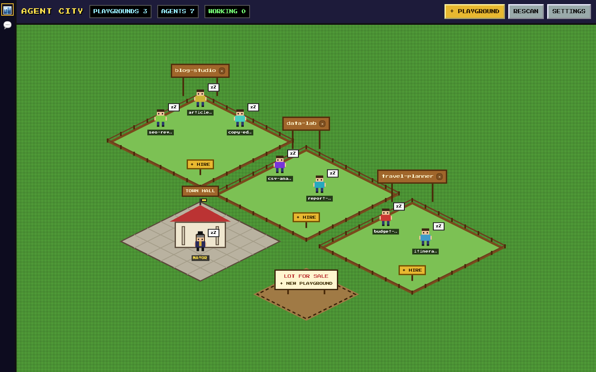
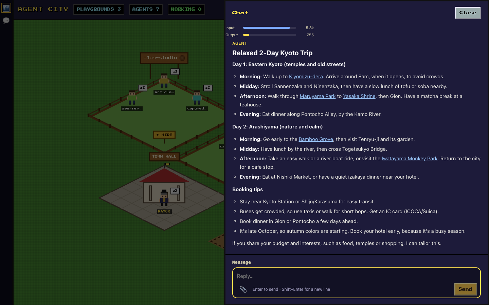
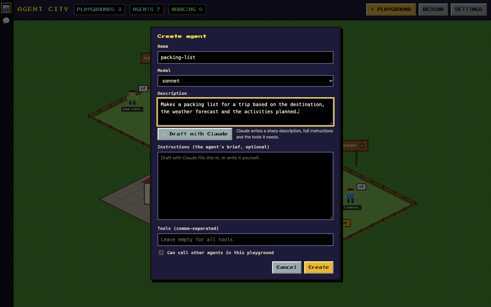
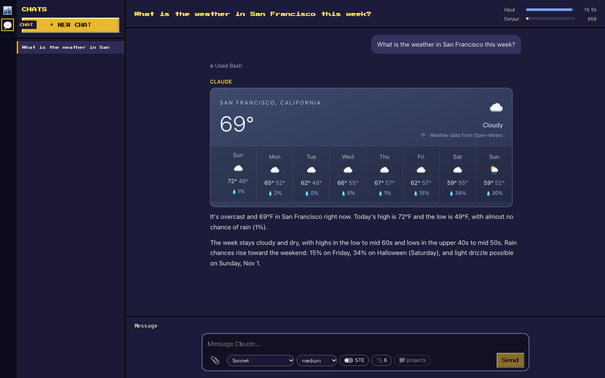

# Agent City

**A pixel-art town for your Claude Code agents.** Agent City is a local web app
that finds the [Claude Code subagents](https://docs.claude.com/en/docs/claude-code/sub-agents)
in your projects and shows them as little people living in playgrounds, one per
project. Click an agent to talk to it, give it a task in the background, or
improve its instructions. Ask the Mayor and it hands the job to the right agents
for you. There is also a full Claude chat built in.

Everything runs on your Mac through the `claude` command you already use. Agent
City has no account of its own and sends nothing anywhere except through Claude
Code.



## Contents

- [Features](#features)
- [Requirements](#requirements)
- [Install](#install)
- [Run it as an always-on app (macOS)](#run-it-as-an-always-on-app-macos)
- [Using Agent City](#using-agent-city)
- [Chat](#chat)
- [Configuration](#configuration)
- [Where your data lives](#where-your-data-lives)
- [Security](#security)
- [Development](#development)
- [License](#license)

## Features

- **A map of all your agents.** Agent City scans the folders you choose for
  projects with a `.claude/agents/` folder. Each project becomes a playground,
  and each agent stands in it. Agents show a status: asleep (idle) or working.
- **Talk to any agent.** Each agent keeps one ongoing conversation that you can
  return to later. Replies render as Markdown, with links, lists and code.
- **Give tasks in the background.** Send an agent a one-off task and keep
  working; it reports back when done.
- **The Mayor.** The Mayor in the Town Hall knows every agent. Ask it for
  something and it picks the right agents, runs them (in parallel when it can)
  and combines their answers.
- **Hire agents with Claude's help.** Describe an agent in your own words and
  **Draft with Claude** writes a clear description, full instructions and the
  tools it needs. **Improve** does the same for agents you already have.
- **New playgrounds.** Create a project folder for new agents from the map.
- **Delete safely.** Deleting an agent or a playground moves it to the macOS
  Trash, so you can get it back. Deleting a project folder in Finder removes its
  playground from the map too.
- **Attach any file.** Images, PDFs, Word documents, text and code files, or
  anything else (up to 25 MB each).
- **Token meter.** Two bars show the input and output tokens used in the
  current conversation.
- **Chat.** A general Claude chat with model, effort and connector choices, a
  live weather card, and an optional Simplified Technical English mode.
  [More below](#chat).
- **Stays up to date.** Open windows notice when you install a new version and
  offer to reload.



## Requirements

- **macOS.** The app itself is a Node web app, but the always-on service, the
  Trash support and Word-document reading use macOS features.
- **Node.js 20 or later.** Check with `node -v`.
- **Claude Code**, installed and signed in. Check that `claude --version` works
  in Terminal. See the [Claude Code setup guide](https://docs.claude.com/en/docs/claude-code/setup).
- At least one project with Claude Code subagents (`.claude/agents/*.md`), or
  create some from inside Agent City.

## Install

1. **Get the code.**

   ```sh
   git clone https://github.com/sayantan92sanyal/agent-city.git
   cd agent-city
   ```

2. **Install the packages.** This also installs the `server/` and `client/`
   packages.

   ```sh
   npm install
   ```

3. **Start it.**

   ```sh
   npm run dev
   ```

   This starts the server on http://localhost:4317 and the web app on
   http://localhost:5173. Open http://localhost:5173 in your browser.

4. **Choose your folders.** Click **SETTINGS**, add one or two root folders
   (for example `~/Documents/Projects`) and save. Agent City searches them for
   projects that have a `.claude/agents/` folder and puts each one on the map.
   Click **RESCAN** later to pick up agents you add outside the app.

## Run it as an always-on app (macOS)

Instead of running `npm run dev` each time, you can install Agent City as a
login service. It then starts when you log in, restarts itself if it crashes,
and serves the whole app at **http://localhost:4317**.

```sh
npm run service:install
```

To give it a Dock icon, open http://localhost:4317 in Safari and choose
**File → Add to Dock**. In Chrome, choose **⋮ → Cast, save and share → Install
page as app**.

| Task | Command |
|---|---|
| Rebuild and restart after you pull or change code | `npm run service:restart` |
| Check that it is running | `npm run service:status` |
| Remove the login service | `npm run service:uninstall` |

Logs are in `~/Library/Logs/AgentCity/server.log`.

The service and `npm run dev` both use port 4317, so uninstall the service
before you develop with `npm run dev`.

## Using Agent City

### Agents

Click an agent to open its card:

- **TALK** opens the agent's ongoing conversation.
- **GIVE TASK** sends a one-off task that runs in the background.
- **IMPROVE** asks Claude to rewrite the agent's description, instructions and
  tools. You review the draft before anything is saved.
- **DELETE** moves the agent's file to the Trash.

An agent is a normal Claude Code subagent file, so you can still edit it by
hand. Agent City reads its `name`, `description`, `tools` and `model`.

### Hiring an agent

Click **+ HIRE** on a playground. Give the agent a name, pick a model and
describe what it should do. Click **Draft with Claude** to have Claude write a
sharp description, the full instructions and the tool list, then edit anything
before you click **Create**. Leave **Tools** empty to give the agent all of
Claude Code's tools.



### Playgrounds

A playground is a project folder. Click **+ PLAYGROUND** (or the lot for sale)
to create a new one in `~/Documents/Projects`. The ✕ on a playground's sign
moves the whole folder, and everything in it, to the Trash after you confirm.

### The Mayor

Click the Mayor in the Town Hall and describe what you need. The Mayor looks at
every agent's description, asks the best-suited agents for help and gives you
one combined answer that says which agent did what.

## Chat

The **Chat** button in the left rail opens a general Claude chat that is not
tied to an agent.



- **Model and effort.** Pick Fable, Opus, Sonnet or Haiku and how hard Claude
  should think.
- **Connectors.** Chat can use the connectors you set up in the Claude desktop
  app or on claude.ai, such as Google Calendar or Gmail. Turn individual ones
  off for a chat with the plug button. You sign in to connectors there, not in
  Agent City.
- **Folder.** Each chat works in a folder you choose before the first message.
  Claude can read and write files there.
- **Live data.** For weather, Chat fetches a live forecast from
  [Open-Meteo](https://open-meteo.com/) and shows it as a card. For other
  current facts it prefers live sources over web-search snippets.
- **STE.** The STE switch makes Claude answer in
  [ASD-STE100 Simplified Technical English](https://www.asd-ste100.org/):
  short sentences, simple words, one instruction per sentence.
- **Small requests.** Chat uses its own short system prompt and only the tools
  a conversation needs, so a simple question costs about 6,600 input tokens.

### Optional: local models

Chat can also talk to models that run on your Mac, through a separate local
model server (a FastAPI + MLX app that serves Llama 3.2 3B and Qwen2.5-VL 7B
on port 8000). If Agent City finds that server's folder, the local models
appear in the model list under **On this Mac (no tools)**. Local models answer
offline but cannot search the web, use files or use connectors.

Set `AGENT_CITY_LOCAL_MODELS_DIR` to the server's folder (it must contain
`server.py` and a `.venv`). Without it, the local models are simply hidden.

## Configuration

Agent City works without any configuration. These environment variables change
its defaults:

| Variable | Default | What it sets |
|---|---|---|
| `AGENT_PANEL_HOME` | `~/.agent-control-panel` | Where settings, chats and history are stored |
| `AGENT_PANEL_PLAYGROUNDS_DIR` | `~/Documents/Projects` | Where new playgrounds are created |
| `AGENT_CITY_PORT` | `4317` | The server port. `npm run dev` and the login service expect 4317 |
| `AGENT_CITY_LOCAL_MODELS_DIR` | `~/Documents/Projects/LocalModelChat` | The local model server's folder |
| `AGENT_CITY_LOCAL_MODELS_URL` | `http://127.0.0.1:8000` | The local model server's address |

## Where your data lives

Everything stays on your Mac:

- `~/.agent-control-panel/config.json`: your root folders.
- `~/.agent-control-panel/chats/`: Chat conversations.
- `~/.agent-control-panel/attachments/`: files you attach.
- `~/.agent-control-panel/state/` and `tasks/`: agent conversations and
  background tasks.
- Your agents stay where they always were, in each project's `.claude/agents/`.

## Security

Agent City runs Claude Code with permission prompts turned off
(`--permission-mode bypassPermissions`), because a web page cannot answer them.
This means agents and Chat can run commands and change files in their folders
without asking. Keep this in mind:

- Only point Agent City at folders you trust, and give agents only the tools
  they need.
- The server listens on `127.0.0.1` only and rejects requests whose `Host` is
  not `localhost`, so other computers on your network cannot reach it.
- Files that agents create are served with a sandboxing Content Security
  Policy, and unknown file types are downloaded rather than opened.

## Development

```sh
npm run dev   # server with the API on :4317, Vite with hot reload on :5173
npm test      # server and client tests (Vitest)
npm run build # build the web app into client/dist
```

Project layout:

```text
server/   Express API that runs the claude CLI (agents, Mayor, Chat, tasks)
  src/chat/     Chat: CLI arguments, runner, storage, connectors, local models
  src/mayor/    The Mayor and its MCP bridge to the other agents
  src/routes/   HTTP routes
client/   React web app, built with Vite
  src/city/     The isometric map, agent cards and dialogs
  src/chat/     The Chat screen
scripts/  The macOS login-service script
```

## License

[MIT](LICENSE)
